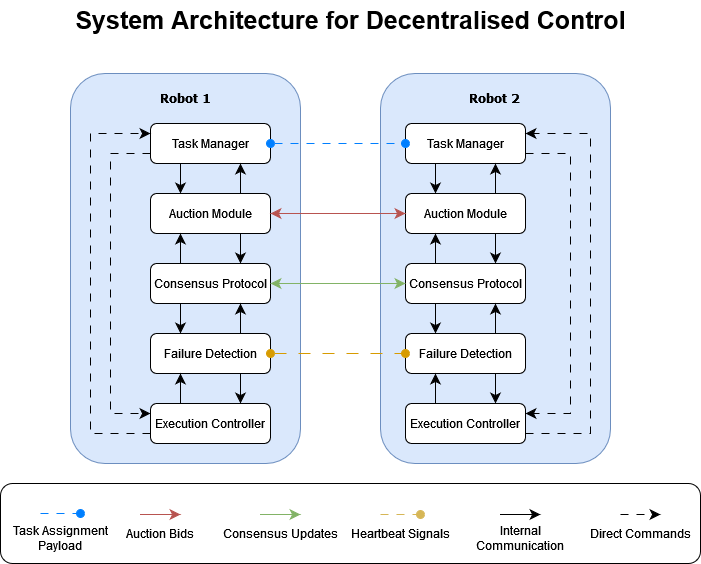
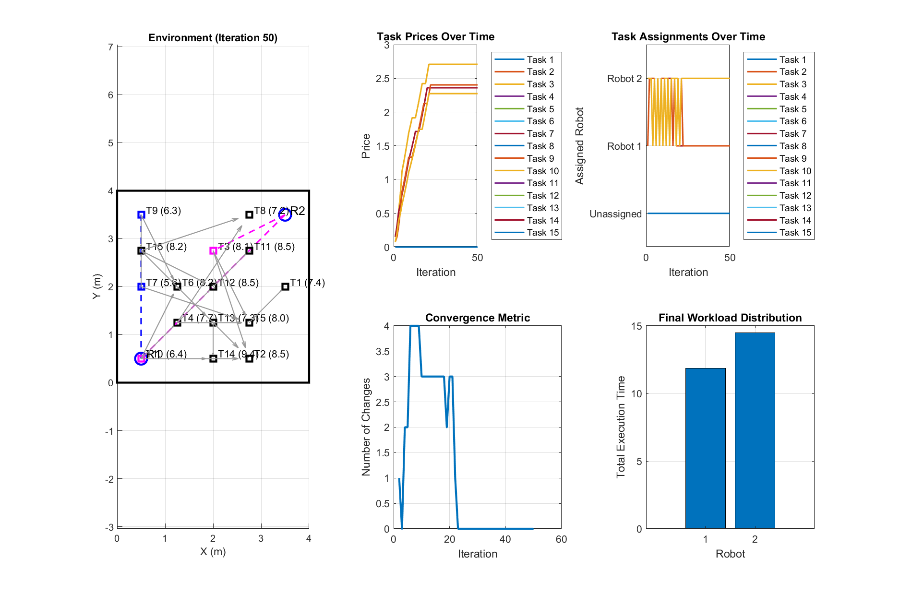
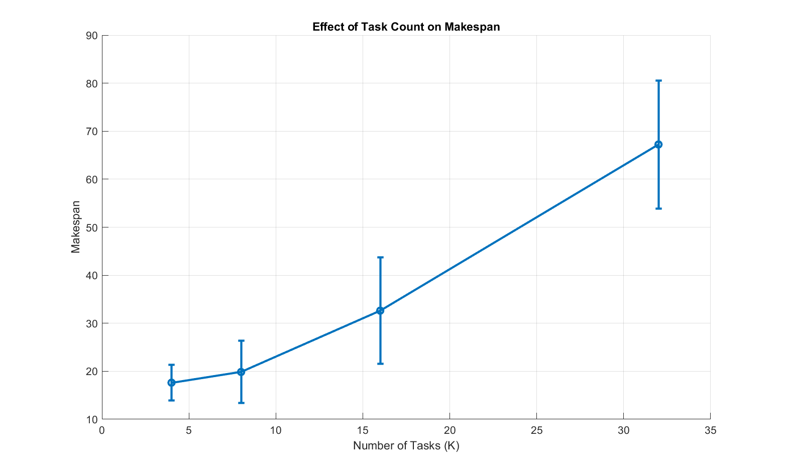
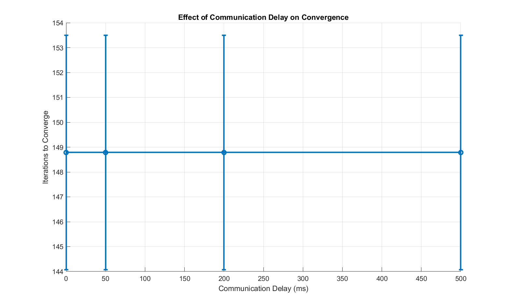
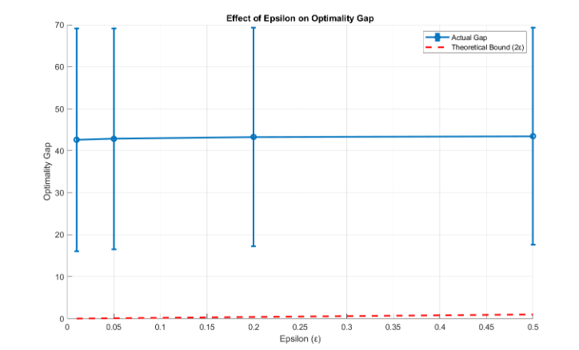
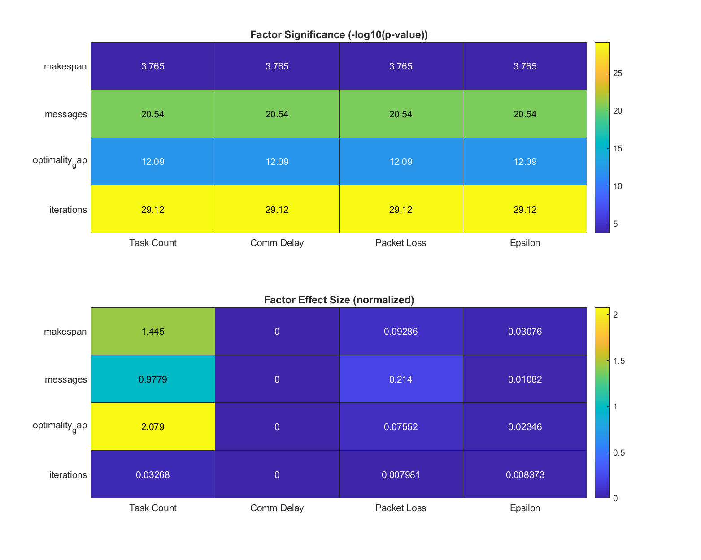

# Distributed Auction Algorithm for Multi-Robot Task Allocation

Simulation framework implementing a distributed auction-based task allocation algorithm for decentralised control of dual mobile manipulators in collaborative assembly tasks.

## Overview

This repository contains the Python implementation of a distributed auction algorithm for decentralised multi-robot coordination, developed as part of a BEng Mechatronics Engineering dissertation at the University of Gloucestershire. A companion MATLAB/Simulink implementation was used for initial algorithm verification and proof-of-concept validation.

The system enables dual mobile manipulators to autonomously allocate tasks among themselves without central coordination, using market-based bidding mechanisms with time-weighted consensus and failure recovery extensions.

**Key features:**
- Decentralised task allocation using distributed auction algorithm
- Time-weighted consensus protocol for state agreement under communication constraints
- Failure detection via heartbeat monitoring with recovery auction mechanism
- Collaborative task handling with leader-follower coordination
- Task dependency management using directed acyclic graphs (DAG) with topological ordering
- Optional GPU-accelerated bid computation via PyTorch
- Interactive GUI for visualisation and parameter tuning
- Experiment framework for full factorial parameter analysis

This implementation extends the theoretical foundations of Zavlanos, Spesivtsev and Pappas (2008) with communication delay tolerance, task dependencies, collaborative tasks, and failure recovery mechanisms.

<!-- Figure 1 from dissertation: System Architecture for Decentralised Control of Dual Mobile Manipulators -->


## Research Context

Developed as part of a BEng dissertation investigating decentralised control architectures for collaborative mobile manipulators. The research aimed to bridge the gap between mathematical auction theory and practical multi-robot coordination under realistic constraints.

The original methodology planned a dual-phase approach — MATLAB for algorithmic verification followed by ROS2/Gazebo simulation on TurtleBot3 Waffle Pi with OpenMANIPULATOR-X. Challenges with the ROS/Gazebo platform (package compatibility, build failures, integration complexity) led to a strategic pivot toward MATLAB and Python implementations for algorithm validation.

**Theoretical targets:**
- Convergence time: O(K² · b_max/ε) iterations
- Optimality gap: ≤ 2ε from centralised optimal
- Recovery time: O(|T_f|) + O(b_max/ε) after robot failure

**Note:** Experimental results revealed discrepancies between these theoretical bounds and practical performance — see the [Results](#results) section below.

## Quick Start

### Installation

```bash
# Clone the repository
git clone https://github.com/knowingwings/decentralized-mobile-manipulator.git
cd decentralized-mobile-manipulator

# Create virtual environment
python -m venv venv
source venv/bin/activate  # On Windows: venv\Scripts\activate

# Install dependencies
pip install -r requirements.txt
```

### Running the Interactive GUI

```bash
python main.py --mode gui --use-gpu
```

The GUI provides:
- Real-time visualisation of robot positions and task allocations
- Interactive parameter tuning (epsilon, alpha weights, etc.)
- Live metrics (convergence, optimality gap, communication overhead)
- Failure injection and recovery testing

### Running Batch Experiments

```bash
# Run factorial experiment with default config
python main.py --mode experiment --config config/factorial_design.yaml --use-gpu
```

### Analysing Results

```bash
python main.py --mode analysis --results results/factorial_experiment.csv
```

## Repository Structure

```
.
├── core/                       # Core algorithm implementation
│   ├── auction.py              # Auction algorithm and bid calculation
│   ├── robot.py                # Robot representation and state
│   ├── task.py                 # Task definition and dependencies
│   ├── simulator.py            # Simulation engine
│   ├── gpu_accelerator.py      # Optional GPU acceleration with PyTorch
│   ├── experiment_runner.py    # Batch experiment execution
│   ├── analysis.py             # Statistical analysis (ANOVA, regression)
│   └── centralised_solver.py   # Optimal baseline (exhaustive/greedy heuristic)
│
├── gui/                        # Interactive visualisation
│   ├── visualisation.py        # Main GUI application
│   ├── control_panel.py        # Parameter controls
│   └── plots.py                # Real-time plotting
│
├── config/                     # Experiment configurations
│   ├── default.yaml            # Default parameters
│   ├── factorial_design.yaml   # Full factorial experiment design
│   ├── gpu_test.yaml           # GPU performance testing
│   └── price_stability.yaml    # Price convergence analysis
│
├── utils/                      # Utility functions
│   ├── data_collector.py       # Metrics collection
│   ├── metrics.py              # Performance metrics
│   └── check_gpu.py            # GPU availability check
│
├── media/                      # Documentation images
│   ├── algorithm-flowchart.png
│   ├── price-convergence.png
│   ├── makespan-scaling.png
│   ├── comm-robustness.png
│   ├── optimality-gap.png
│   └── factor-effects.png
│
├── main.py                     # Entry point
├── requirements.txt            # Python dependencies
└── README.md                   # This file
```

## Algorithm Details

### Distributed Auction Algorithm

Each robot maintains local bid values, price estimates, and task assignments. Robots bid on tasks based on local cost estimation and coordinate through peer-to-peer message passing without any central controller.

**Bid calculation:**
```
bid_ij = α₁·d_factor + α₂·c_factor + α₃·capability_match
         - α₄·workload_factor - α₅·energy_factor
         + global_balance_factor + unassigned_bonus + iteration_factor
```

Each factor is normalised and weighted to balance distance, configuration transition cost, capability matching (dot product of robot capabilities and task requirements), workload distribution, and energy consumption.

**Price update with ε-complementary slackness:**
```
price_j ← price_j + effective_epsilon
```

The effective epsilon adapts based on task oscillation count to dampen cycling behaviour.

**Time-weighted consensus:**
```
x_consensus = x_i + Σ γ·exp(-λ·Δt)·(x_j - x_i)
```

Information from other robots is weighted by an exponential decay factor based on the age of the information, allowing the protocol to gracefully handle communication delays.

### Task Dependencies

Tasks are represented as a directed acyclic graph (DAG). Dependencies are added with cycle prevention (only allowing edges from earlier to later tasks in spatial ordering), capped at 3 prerequisites per task, and with transitive dependencies removed to simplify the graph.

### Failure Recovery

When a robot fails:
1. Failure detected via heartbeat timeout
2. Orphaned tasks identified from the failed robot's assignment list
3. Recovery auction initiated with modified bid function: `b_r_ij = b_ij + β₁·(1 - progress) + β₂·criticality + β₃·urgency`
4. Tasks reallocated to operational robots

### Centralised Baseline

For comparison, a centralised solver provides optimal or near-optimal solutions: exhaustive search for small problems (K ≤ 8) and a greedy heuristic (earliest-finish-time assignment with topological ordering) for larger problems.

## Configuration

### Key Parameters

| Parameter | Description | Default | Tested Range |
|-----------|-------------|---------|--------------|
| epsilon (ε) | Minimum bid increment | 0.05 | 0.01–0.5 |
| alpha1 (α₁) | Distance factor weight | 0.8 | — |
| alpha2 (α₂) | Configuration cost weight | 0.3 | — |
| alpha3 (α₃) | Capability match weight | 1.0 | — |
| alpha4 (α₄) | Workload balance weight | 1.2 | — |
| alpha5 (α₅) | Energy cost weight | 0.2 | — |
| gamma (γ) | Consensus protocol weight | 0.5 | — |
| lambda (λ) | Information decay rate | 0.1 | — |
| comm_delay (τ) | Communication delay (ms) | 0 | 0–500 |
| packet_loss (p_loss) | Packet loss probability | 0 | 0–0.5 |
| K | Number of tasks | 8 | 4–32 |

See `config/default.yaml` for full configuration options.

### Experimental Design

Evaluation used a full factorial design across four control variables (K, τ, p_loss, ε) with response variables: makespan, message count, optimality gap, and recovery time. Statistical analysis included ANOVA, regression modelling, and 95% confidence intervals.

## Results

Results from the dissertation's experimental evaluation (2 robots, 4m × 4m workspace).

### Convergence Behaviour

<!-- Figure 4: Auction Algorithm Results for 10 Task Assignments (or Figure 5 for 15 tasks) -->


Stable task allocations achieved within ~25–30 iterations for 10–15 task scenarios, with monotonically increasing price behaviour stabilising at equilibrium.

### Scaling Performance

<!-- Figure 6: Effect of Task Count on Makespan -->


Near-linear makespan increase from ~17.5 to ~67 time units as tasks grew from 4 to 32. Communication efficiency scaled as O(K) vs O(K²) for centralised methods.

### Communication Robustness

<!-- Figure 7: Effect of Communication Delay on Convergence -->


Convergence time remained consistent (~148.8 iterations) across all delays 0–500ms. System remained functional at 50% packet loss.

### Comparative Performance

<!-- Figure 9: Effect of Epsilon on Optimality Gap (MATLAB). The 0.85-to-0.72 performance ratio is discussed in Section 5.1.3 prose only — no dedicated figure. Consider also Figure 14 (Python optimality gap vs epsilon) -->


0.85 performance ratio vs centralised optimal for K ≤ 8, degrading to ~0.72 at K = 32.

### Factor Analysis

<!-- Figure 10: Factor Impact Analysis -->


Task count dominated performance impact (effect size 2.079 on optimality gap, 1.445 on makespan). Communication delay had negligible effect. Strong negative correlation between message count and optimality gap.

### Known Limitations

- **Optimality gap exceeds theoretical bound**: MATLAB implementation gap (~43) far exceeded the 2ε bound; Python implementation showed negative gap (~−0.72) — both suggest the ε-complementary slackness conditions are not properly maintained in the bid/price mechanism
- **Epsilon has no measurable effect**: ANOVA reported p = 1.0 for epsilon across all metrics in the Python implementation, indicating an implementation issue in how epsilon influences the price update rule
- **Recovery mechanism non-functional**: Recovery time reported as zero across all configurations due to logic errors in recovery completion detection — the theoretical recovery bound could not be validated
- **Premature convergence**: Algorithm occasionally terminates with unassigned tasks because convergence criteria prioritise assignment stability over completeness
- **Communication delay invariance**: The flat convergence curve across all delay values may indicate the delay simulation is not correctly affecting the auction process
- **High parameter sensitivity**: Optimal alpha/beta weights varied substantially across problem sizes, requiring manual tuning

These limitations are discussed in detail in Section 6 of the dissertation and represent clear directions for future improvement.

## Future Work

- Fix epsilon integration in the price update mechanism and validate against theoretical bounds
- Redesign recovery detection with explicit state tracking and deterministic recovery sequences
- Enhance convergence criteria to enforce complete task allocation before termination
- Develop adaptive parameter auto-tuning based on problem characteristics
- Extend beyond two robots to evaluate scaling and topology effects
- ROS2/Gazebo integration for sim-to-real validation on TurtleBot3 with OpenMANIPULATOR-X
- Look-ahead planning for critical path-aware task dependency handling

## Related Work

**Theoretical Foundation:**
- Zavlanos, M.M., Spesivtsev, L. and Pappas, G.J. (2008). "A distributed auction algorithm for the assignment problem." *IEEE CDC*, pp. 1212–1217.
- Bertsekas, D.P. (1988). "The auction algorithm: A distributed relaxation method for the assignment problem." *Annals of Operations Research*, 14(1), pp. 105–123.

**Consensus Protocols:**
- Olfati-Saber, R., Fax, J.A. and Murray, R.M. (2007). "Consensus and Cooperation in Networked Multi-Agent Systems." *Proceedings of the IEEE*, 95(1), pp. 215–233.
- Talamali, M.S. et al. (2021). "When less is more: Robot swarms adapt better to changes with constrained communication." *Science Robotics*, 6(56).

**Multi-Robot Coordination:**
- Shorinwa, O. et al. (2023). "Distributed Optimization Methods for Multi-Robot Systems: Part 2 — A Survey." *IEEE RAM*.
- Rossi, F. et al. (2021). "Multi-Agent Algorithms for Collective Behavior: A structural and application-focused atlas."

## Citation

```bibtex
@thesis{lehuray2025distributed,
  author  = {Le Huray, Tom},
  title   = {Employing a distributed auction algorithm in decentralised mobile
             manipulators for independent and collaborative assembly tasks},
  school  = {University of Gloucestershire},
  year    = {2025},
  type    = {BEng Dissertation},
  url     = {https://github.com/knowingwings/decentralized-mobile-manipulator}
}
```

## License

Apache License 2.0: see `LICENSE` and `NOTICE`.

The first version (commit `0add095`, 2 March 2026) was published under the MIT licence, and copies of it stay under MIT.

## Author

**Tom Le Huray**
- GitHub: [@knowingwings](https://github.com/knowingwings)

BEng Mechatronics Engineering, University of Gloucestershire

---

*Developed as part of research in decentralised multi-robot coordination, submitted in partial fulfilment of the requirements for the degree of Bachelor of Mechatronics Engineering.*
